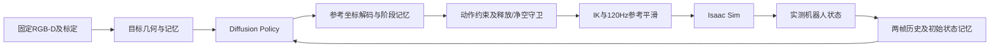
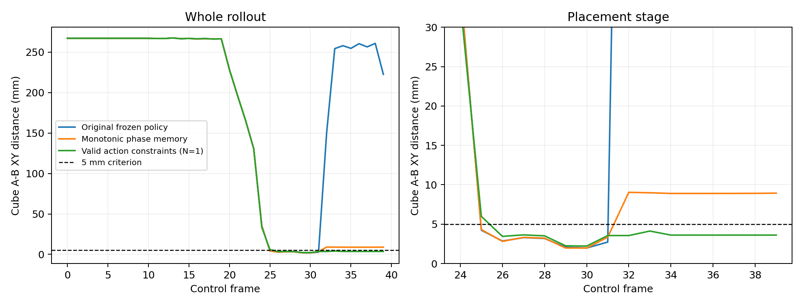
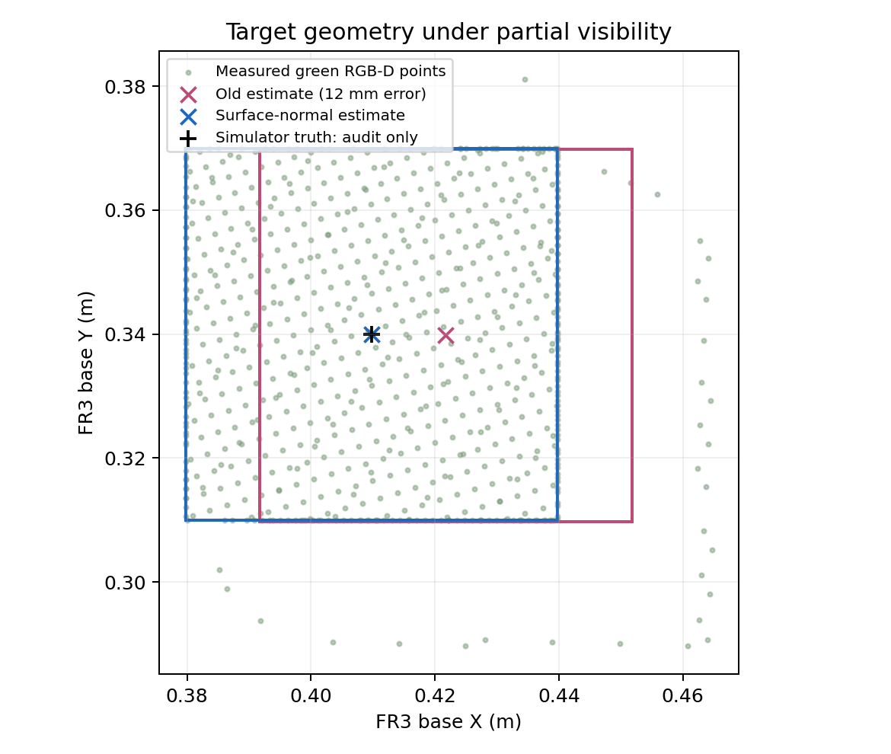

# DemoGrasp现有数据优化：最终验证报告

当前推荐系统在8个已提供且可复现的布局上取得 **90/90**，在16组局部A/B组合检查中取得 **46/48**。对应权重、配置和代码在组合检查前冻结。

这些成绩支持“当前可用场景已达到较高执行质量”，不能据此宣称公开基准SOTA。原测试场景在开发中用于错误定位，后续成绩均标为回归；局部组合共享4个背景，也曾做过观测审计。

## 结果与数据角色

| 部分 | 布局数 | 次数 | 解释 |
|---|---:|---:|---|
| 训练布局回归 | 4 | 20/20 | 使用原398条训练数据 |
| 原验证布局回归 | 1 | 10/10 | 用于选模 |
| 后续用于诊断的布局回归 | 3 | 60/60 | 原测试1个＋保留包2个 |
| 局部A/B组合检查 | 16 | 46/48 | 未用于训练或策略成绩选模，共享4个背景 |

必须保留的历史结果：第一版冻结策略独立测试为2/20；修复后第二次冻结测试为19/40。之后这些布局被用于诊断，不能把最终回归结果重新包装成独立测试。

训练始终只用原有398条、4个布局。用户接手新数据生成后，没有新增训练演示。16组局部布局是在分工调整前已经采集并隔离的产物，本轮只用于补充评估。原17号数据组仍未通过当前运行时的专家回放，继续隔离，不计入策略成绩。

两个保留包原始演示是8Hz。本轮只复用其中场景资产和实测reset，在统一4Hz、40步协议下评估；没有重标演示或混入训练。对应4Hz专家可行性回放通过。所有布局按物理位姿核对，避免仅凭目录名造成假隔离。

| 指标 | 8个原始布局回归 | 16组局部组合 |
|---|---:|---:|
| 平均最终XY误差 | 1.233 mm | 1.071 mm |
| 最大稳定窗口XY误差 | 4.596 mm | 5.330 mm |
| 最大高度误差 | 0.004 mm | 0.004 mm |
| 最大稳定漂移 | 0.009 mm | 0.024 mm |
| 最大稳定窗口速度 | 3.969 mm/s | 4.136 mm/s |
| IK失败 | 0 | 0 |
| 全局工作空间额外限幅 | 0 | 0 |
| 禁用障碍接触试验数 | 0 | 0 |

验收仍为XY≤5mm、中心高度差50±4mm、漂移<1mm、速度<50mm/s、实际抓起/释放/堆叠接触、无禁用盒障碍接触。40次4Hz策略动作后使用原固定物理稳定窗口。执行约束和守卫有单独计数；工作空间限幅为0不代表神经网络输出未经修正。

## 当前方案

环境仍是Isaac Sim6、FR3V2、4cm/6cm方块和盒障碍。最终神经网络采用RGB-D测得的目标几何、实测机器人状态、初始状态记忆和Diffusion Policy；没有采用PointNet特征。腕部与融合PointNet对照均保留。

训练使用H=2、K=16、A=8，DDPM100、sample预测、EMA、batch32、seed42，完整训练40k步，最终权重取20k EMA。最近两帧观测每个控制周期更新，动作队列为空时重规划。额外记忆保存实际obs[0]与首次有效RGB-D目标，不把reset命令当测量值。

关键实现：

1. RGB-D目标定位使用真实深度面法向及深度边界，修复反光/局部遮挡造成的12–15mm偏差。已知绿色、6cm尺寸和轴对齐是明确的任务先验。
2. 动作按初始位置与测量目标表示为路径残差。训练用专家阶段提供额外监督；推理阶段和进度由网络预测，不读取专家阶段或绝对帧号。
3. “搬运已开始”事件被锁存到显式reset，避免开爪时错误返回抓取坐标系。
4. 输出遵守训练中实际存在的固定朝向和开/闭夹爪取值；预测到达目标后，水平目标对齐测量目标，下降目标不低于名义堆叠高度。
5. 模型提出开爪请求后，执行层检查名义放置命令与实测机器人姿态是否稳定，再打开并保持片刻。守卫不读取物体真值、接触或奖励，也不自行宣布堆叠成功。
6. 120Hz执行层对关节/夹爪目标加入40ms参考平滑，减少瞬时跳变引起的滑移。静态驱动增益、原始reset和资产不变，高层仍为4Hz。
7. 根据RGB-D目标高度建立搬运净空：目标较高时先升高，再沿模型提出的水平方向移动；到目标上方后约束下降。没有读取盒障碍真值地图，但它也不是对任意障碍排列的完整避障规划器。

这是“学习动作规划＋观测几何与执行守卫”的任务专用系统，不是纯端到端视觉策略的SOTA证明。所有实际动作仍经过同一IK/物理路径，成功由独立物理量检验。



## 主要对照结果

| 方案 | 已见训练布局 | 原未训练验证布局 |
|---|---:|---:|
| 原20条腕部基线 | 19/20 | 0/10 |
| 全398条腕部基线 | 17/20 | 0/10 |
| 全398条融合＋TCP参考PointNet | 3/20 | 0/10 |
| 全398条空间注意力编码 | 0/20 | 0/10 |
| 初始/目标参考＋腕部编码 | 15/20 | 10/10 |
| 目标几何修复＋状态参考 | 20/20 | 10/10 |
| 当前带执行守卫系统 | 20/20 | 10/10 |

原验证布局相同，但后期用过闭环选模。架构、额外监督、输入信息和执行层均有变化，不能把全部收益归因于某一个模块。单次采样加动作约束为49/50回归，4次平均为47/50且增加碰撞，因此采用单次采样。稳定释放守卫达到50/50；参考平滑把这50次的平均XY误差从2.057mm降至0.624mm。随后发现升高目标需要净空约束，最终按8个布局重新回归。



同一已知回归样本的过程图：原策略到达目标后返回抓取区，阶段锁存修复回退，动作约束改善放置。图不是总体成功率。



绿色点为真实RGB-D；真值标记只用于审计，不进入定位器或动作生成。

## 复现入口

推荐checkpoint：`lerobot_policy/outputs/existing398_20261021/height_aware_policy`。保留完整目录和对应推理代码，使用本项目加载入口。

```bash
/home/houshengyuan/anaconda3/envs/lerobot/bin/python lerobot_policy/run_delivery_sweep.py \
  --checkpoint lerobot_policy/outputs/existing398_20261021/height_aware_policy \
  --list data/evaluation_manifests/fr3v2_existing_holdouts_20261021/all_known_scenes.jsonl \
  --indices 0 1 2 3 4 5 6 7 --seeds 0 --mode policy \
  --output lerobot_policy/outputs/new_review_run --sim-gpus 0 1 --server-gpu 2
```

不要把scene_only/evaluation_only清单交给训练器。新数据若改变TCP/抓取放置高度、阶段长度或颜色尺寸约定，需要更新合同和监督标签。

## 限制与证据

当前全部可复现的上传布局都已产生调试反馈，没有仍然完全独立的新障碍背景。局部组合检查虽未用于训练和策略成绩选模，但共享已有背景且曾做观测审计。下一批数据应留出从未用于调试的完整布局，才能继续判断广泛泛化。公开SOTA还需要明确基准和同协议对照。

方法参考[DP3](https://3d-diffusion-policy.github.io/)与[RISE](https://rise-policy.github.io/)的3D表示思路；本实现不是这些方法的完整复现。最初独立测试失败记录、所有有效策略失败及端口故障重试均保留。端口问题通过预留socket和身份/配置哈希校验修复，只重跑执行异常或未完成试验。

使用GPU0、1、2。原始NPZ、USD、URDF和训练清单保持不变。源码/权重冻结及详细结果见下方清单。

[最终质量汇总](final_quality_summary.json) · [执行与冻结清单](execution_manifest.json)
